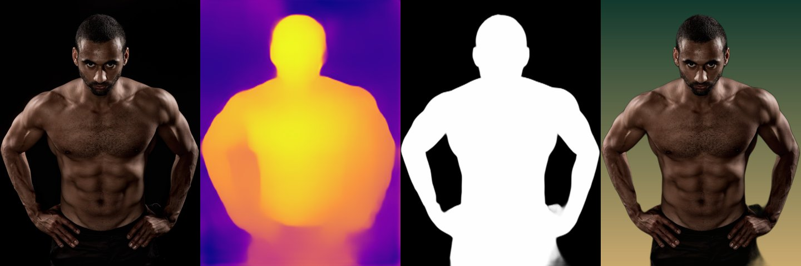
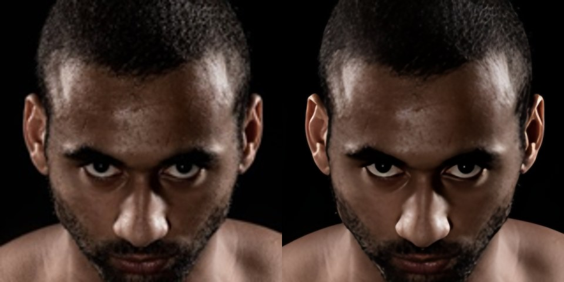

# cpu-vision-models

**Depth maps, person cutouts and x4 upscaling on a plain CPU, with no PyTorch, no Hugging Face and no GPU.**




*Original → depth (MiDaS) → person mask (U²-Net) → cutout on a new background. All of it on 2 CPU cores.*

Many locked-down environments block `huggingface.co` and `download.pytorch.org`: agent sandboxes, CI runners, corporate proxies. They do allow GitHub releases and PyPI. This package uses three well-known models whose weights are published as GitHub releases, and runs them through `onnxruntime`, so you get:

- **Depth:** [MiDaS v2.1 small](https://github.com/isl-org/MiDaS). Use it for 2.5D parallax, depth fog or fake depth of field.
- **Person segmentation:** [U²-Net human-seg](https://github.com/xuebinqin/U-2-Net) (the model behind rembg's person mode). Use it for cutouts, background swaps and silhouette effects.
- **x4 super-resolution:** [Real-ESRGAN realesr-general-x4v3](https://github.com/xinntao/Real-ESRGAN). It only ships as a PyTorch `.pth`, so this repo **reads the checkpoint without torch and builds the ONNX graph itself**.

## Quick start

```bash
pip install git+https://github.com/Hybrid333/cpu-vision-models
cpuvision fetch                          # ~250 MB from GitHub releases, resumable, sha256-verified

cpuvision depth   photo.jpg depth.png --color
cpuvision mask    photo.jpg mask.png
cpuvision mask    photo.jpg cutout.png --cutout
cpuvision upscale small.jpg big.png               # --blend 1.0 for the raw network output
```

```python
from PIL import Image
import cpuvision as cv

img = Image.open("photo.jpg")
d = cv.depth(img)                 # float32 HxW, 0..1, 1 = near
cv.colorize(d).save("depth.png")
mask = cv.person_mask(img)        # PIL "L", 255 = person
cv.cutout(img, mask).save("cutout.png")
cv.upscale(img).save("x4.png")
```

Weights are cached in `~/.cache/cpuvision`. Set `CPUVISION_HOME` to use another folder.

## Speed

Measured warm on a 2-core cloud VM with onnxruntime 1.29:

| Task | Input | Time |
|---|---|---|
| Depth | 720×960 | 0.09 s |
| Person mask | 720×960 | 0.83 s |
| x4 upscale | 160×160 → 640×640 | 0.46 s |
| x4 upscale | 464×688 → 1856×2752 | 6.6 s |

Depth runs at about real-time video rate. For masks on video, compute them at ~6 fps and interpolate between frames. Upscaling is meant for stills and keyframes.



*Left: bicubic ×4. Right: `cpuvision upscale` (blended 60/40 with bicubic). Look at the edges of the eyes, ears and beard.*

## How the torch-free Real-ESRGAN works

1. **Read the `.pth` as a zip.** A modern checkpoint is `data.pkl` (the object tree) plus `data/<key>` files holding raw tensor bytes. [`torchless.py`](cpuvision/torchless.py) unpickles it with a *restricted* unpickler. Only `OrderedDict` and torch's two tensor-rebuild functions are allowed, so a malicious checkpoint can't execute code. Storages become numpy buffers, and tensors are rebuilt with `as_strided`.
2. **Rebuild the network in ONNX.** [`esrgan_onnx.py`](cpuvision/esrgan_onnx.py) writes SRVGGNetCompact with `onnx.helper`: 33× Conv + per-channel PReLU, `DepthToSpace(4, mode=CRD)` for PixelShuffle, plus a nearest-neighbour upsample of the input added back as a residual.
3. **Two details that bite:** set `model.ir_version = 8` (many onnxruntime builds reject newer IR versions), and give the PReLU slopes shape `(C,1,1)` so they broadcast per channel.
4. **Run in tiles** with a 16 px overlap so memory stays flat on large images, then blend with bicubic (default 0.6). On its own the compact model looks slightly waxy.

## Use it as an agent skill

[`skill/SKILL.md`](skill/SKILL.md) is a ready-to-use Agent Skill (Claude Code and other agents that load skill folders). It tells an agent when these models help, what they cost, and the pitfalls above.

## Limits

- MiDaS small was trained on photographs. On game renders and flat CGI it returns a smooth gradient rather than object-level depth.
- U²-Net human-seg is for people. For products or animals, use rembg's general `u2net` model.
- These are 2019–2021 models chosen because they run anywhere. Newer models (Depth Anything, SAM 2) are more accurate but need PyTorch or much larger downloads.

## Licenses

Code: [MIT](LICENSE). Model weights keep their own licenses: MiDaS (MIT), U²-Net (Apache-2.0), Real-ESRGAN (BSD-3-Clause). They are downloaded from the original releases, not redistributed here. The demo photo in `docs/` shows the repo author, is used with permission, and is **not** covered by the MIT license.
